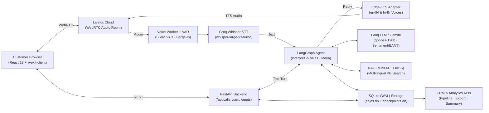

# FlowCRM AI Sales Voice Agent — Project & Architecture Report

**Bilingual (EN/HI) Real-Time Voice & Text Sales Qualification MVP** | FastAPI · LiveKit · LangGraph · Groq · FAISS · React 19

---

## 1. Business Problem & Implemented Solution

SMB sales teams lose 40–60% of inbound leads due to slow follow-ups, after-hours drop-offs, language barriers, and manual CRM entry. FlowCRM's AI Voice Agent (**Maya**) delivers sub-second bilingual (**English & Devanagari Hindi**) voice and text conversations that answer product questions via RAG, qualify leads (`0–100` score), book conflict-free demo slots, and log structured CRM insights.

---

## 2. System Architecture Flowchart

---

## 3. APIs, AI Models & End-to-End Business Workflow

- **Voice & AI Stack:** LiveKit Cloud WebRTC + Silero VAD (barge-in) + Groq Whisper STT (`whisper-large-v3-turbo`) + LangGraph (`interpret -> sales`) + Groq LLM (`openai/gpt-oss-120b`, `gemini-2.5-flash` fallback) + Edge-TTS (`en-IN-NeerjaNeural` / `hi-IN-SwaraNeural`) + `paraphrase-multilingual-MiniLM-L12-v2` + FAISS (`IndexFlatIP`).
- **End-to-End Workflow:**
  1. Instant greeting on voice or text session start.
  2. Multilingual Q&A grounded in `knowledge_base/` (`company.md`, `products.md`, `pricing.md`, `integrations.md`, `faq.md`, `policies.md`).
  3. Live BANT (`90` pts) + contact (`15` pts) + booked demo (`35` pts) lead scoring (`Cold` / `Warm` / `Hot`, capped at `100`) & turn-level sentiment.
  4. Guided slot confirmation stored conflict-free in SQLite `appointments`.
  5. Post-call LLM summary (`call_analysis`), visible in **Call console**, **Call history**, and **Dashboard** (Overview, Pipeline, Appointments).

---

## 4. Scalability (1,00,000 Users), Security, Costs & Dependencies

- **100K User Scaling:** `100,000` users (`~10,000` calls/day × `5` min over `10h`) ≈ `84` average / `~250` peak concurrent calls (`~1.5M` min/month). Scale via managed PostgreSQL + Redis distributed locks, `pgvector` / Qdrant for multi-tenant RAG, autoscaled containerized LiveKit voice workers, and async post-call summary queues.
- **Security, Feasibility & Dependencies:** API keys stay server-side; browsers receive 10-min room-scoped JWTs; no raw audio is persisted. SaaS pricing (`₹999–₹2,999/month` + metered minutes) covers WebRTC, STT, LLM, and SLA-backed TTS costs. All runtime imports are verified in [`requirements.txt`](requirements.txt) and [`requirements-live.txt`](requirements-live.txt).
