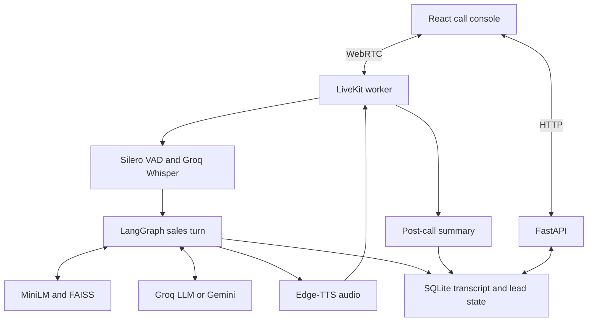

# System architecture

LiveKit manages microphone transport and audio playout. Silero detects utterance boundaries and speech during playback. The worker transcribes each completed utterance, runs a LangGraph turn, and returns Edge-TTS audio over the room. Groq Whisper transcribes complete utterances. The audio adapter decodes MP3 into PCM and closes its stream when playback is cancelled.

The sales graph retrieves product snippets and uses conversation history when interpreting a turn. Customer-disclosed facts update BANT. Budget and need each contribute 30 points. Authority and timeline each contribute 20. Scores of 75 and above are Hot. Scores of 45–74 are Warm. Scores below 45 are Cold. The current scoring measures how much of BANT has been established. It is useful for follow-up and does not predict purchase likelihood.

The UI uses FastAPI for room tokens, session transcripts and analytics. A finalization task creates the summary, sentiment, objections and next action after the call. Analytics count completed sessions and offer a mode filter.
